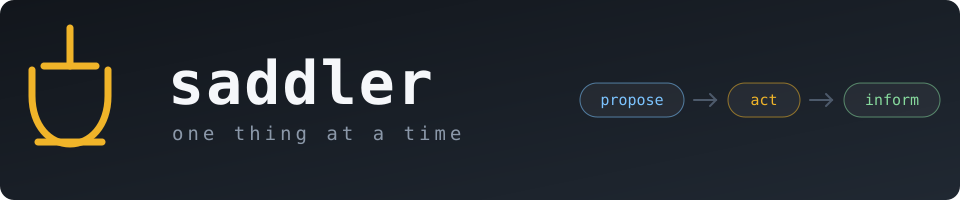

  

# Saddler: Per-Project Harness Setup Wizard

To install: `bash install.sh`

To invoke: run claude code in project folder; in claude code, type one of
- `/fileguard`: sandbox Bash, and give every session and subagent its own view of the project
- `/codeguide`: software engineering instructions
- `/mathguide`: formally verified (Lean) math project instructions
- `/evalguide`: system evaluation repository layout
- `/tokenline`: status line `<TOKEN COUNT> @ <FOLDER> (<BRANCH>)`

# Design

A rough model of producitivity is `PRODUCTIVITY ∝ #TASKS / (#TURNS * AVERAGE TURN TIME)`

This is a wrong model considering task difficulty or a task may set user backwards towards overall goal. 

But here we assume it is true, since the agent is here to complete user tasks.  

We also assume human can capture agent errors instantly. 

## Minimize Redundant Turns

Count a turn as redundant if the agent does something user doesn't expect. 

Mitigation:
- Setup a feedback loop: build good enough unit tests
- Let the agent present a code skeleton: user know what will happen before it does
- Each term process one issue, so agent does not mix multiple jobs

## Minimize Average Turn Time

User must process agent's feedback. That takes time. 

Mitigation:
- Delay elaboration: less information, more turns, save reading time when you already know the context
- Make edits visible: user knows it immediately when things indeed go wrong
- Essential presets: so user doesn't have to enter them each time
- Progressive: stop at steps where human may disagree with the agent; let errors bubble earlier

## User Obligation

Agent's intelligence dilutes with context length. User must know that.  

# TODO

## fileguard

Bugs and risks:
- [x] BUG3: Hidden left-behind processes: fixed by giving each holder a PID namespace, which also hides host processes from commands.
- [x] BUG5: PID reuse could make a stale lock file point at an unrelated process, which could then be killed, most likely after a reboot: fixed by recording each holder's start time.
- [x] BUG6: A folder converted from tracked to ignored replaced a live fork's copy and dropped its work from the branch: gone, because every view now has one overlay of the whole project.
- [x] BUG7: Moving an upper into real ran `chmod -R` on the trash folder, whose files are hard links into real, so moved files became executable: fixed by changing only folders.

Known limits:
- [x] LIMIT1: `cargo clean` failed because `target/` was a mountpoint: gone, ignored folders are no longer mounted on their own.
- [ ] LIMIT2: The real files change only at `git checkpoint`, so your terminal, editor and hooks see the last checkpoint.
- [ ] LIMIT3: A checkpoint kills every running command after the wait, long builds and servers included, and discards every agent's uncommitted work.
- [x] LIMIT4: Each base copied single ignored files in full: gone, there are no base copies.
- [ ] LIMIT5: Writers outside Claude: editing tracked files in the real project changes every view's lower, makes `git checkpoint` refuse in views that see the edit, and is saved to a rescue branch and replaced at the next checkpoint. Assumes fileguard's hooks are the only hooks.
- [ ] LIMIT6: A checkpoint is assumed to succeed. One interrupted is finished by the next command; one that keeps failing needs a manual fix.
- [x] LIMIT7: A new single ignored file triggered a checkpoint: gone, checkpoints run only on `git checkpoint`.
- [x] LIMIT8: A subagent lost its background commands and gitignored writes at each turn end: gone, a view stays until the next checkpoint.
- [ ] LIMIT9: Nothing prunes the real objects between checkpoints, so the store grows with every published object.
- [ ] LIMIT10: Read, Write, Edit, NotebookEdit, Grep and Glob are refused in projects with a commit, so agents work through Bash and cannot look at images or PDFs there.
- [ ] LIMIT11: A finished subagent's holder, background commands and upper stay until the next checkpoint or until its Claude process exits.
- [ ] LIMIT12: `rw ~/.cargo/registry` still lets a sandboxed command change extracted crate sources, whose build scripts run when you build outside the sandbox.

Not yet verified:
- [ ] TEST1: A real `git checkpoint` with live subagents, including preemption.
- [ ] TEST2: A real interrupted checkpoint and its recovery.
- [ ] TEST3: A second live session and its `!` commands, each on its own view.
- [ ] TEST4: A real `cargo` build on a large `target/`, before and after a checkpoint.
- [ ] TEST5: A project-level `env` block reaching `sandbox.sh` and `git checkpoint`.
- [ ] TEST6: No model check of the current protocol; `protocolmodel.py` modelled the previous one.
- [x] TEST7: Read through `/proc/<holder>/root` in live Claude Code: failed, Claude Code resolves the path back to the host and reads the real files, so the file tools are now refused.
- [ ] TEST8: Whether `!` commands get the Bash tool's timeout, which a long build in `!git checkpoint` would hit.
